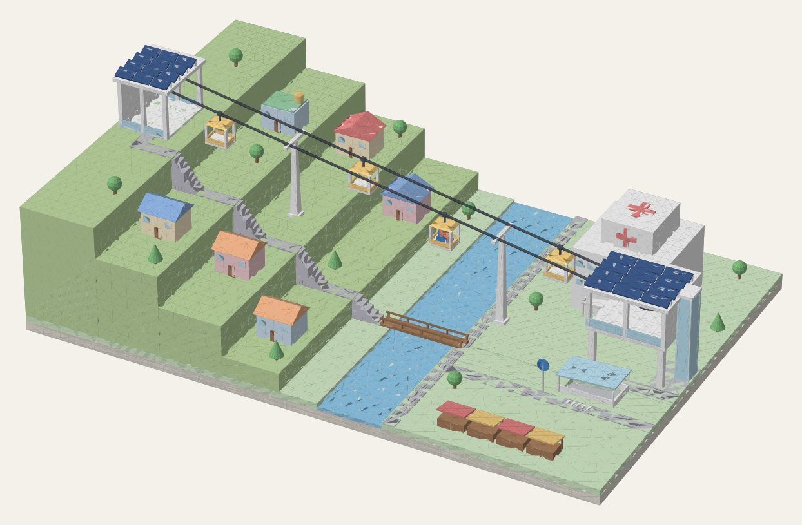

# 산비탈 마을 곤돌라 디오라마 (Tinkercad용)



큰 계단 4단으로 된 언덕 위의 집 6채, 다리에서 꼭대기까지 한 줄로 오르는 골목 계단길, 강,
그리고 강 건너 병원·지하철역·시장(가판대 4칸).
언덕 꼭대기 마을에서 병원·지하철역까지 도시형 곤돌라가 일직선으로 이어지고,
양쪽 정거장 지붕엔 태양광 패널이 덮여 있으며, 강 위를 지나는 곤돌라 칸 하나에는
휠체어를 탄 사람이 타고 있습니다. 아래 정거장에는 엘리베이터와 병원으로 가는 하늘다리도 있어요.

- 크기: **180 × 120 mm**, 높이 약 60 mm (Tinkercad 기본 작업판 200×200 안에 들어갑니다)
- 글자는 넣지 않았습니다.

## Tinkercad로 가져오기

### 빠르게 (한 덩어리)
1. Tinkercad 디자인 화면 오른쪽 위 **가져오기(Import)** 클릭
2. `all_in_one.stl` 선택 → 단위 **밀리미터**, 크기 **100%** → 가져오기
3. 전체가 한 색으로 들어옵니다.

### 색깔까지 살리기 (추천)
1. `tinkercad_parts.zip`을 받아 압축을 풀거나 `stl/` 폴더의 파일을 씁니다.
2. 파일 21개를 **하나씩 가져오기** 합니다 (단위 mm, 100%).
3. 각 파일은 아래 표의 색으로 바꿉니다 (도형 선택 → 색상 → 사용자 지정에 HEX 입력).
4. 가져온 위치가 어긋나 있으면 전부 선택(Ctrl+A) → **정렬(L)** 로 가운데·가운데 정렬하면 딱 맞습니다.
   모든 파일의 바닥 크기가 바닥판과 똑같도록, 바닥판 모서리 속에 0.3 mm짜리 숨은 정렬 조각을 넣어 두었습니다.

| 파일 | 내용 | 추천 색 |
|---|---|---|
| `01_base_plate.stl` | 바닥판 | `#E9E4DA` |
| `02_ground.stl` | 평지 잔디 | `#CFE8C4` |
| `03_hill_terrace.stl` | 언덕 계단식 지형 | `#BFD8A2` |
| `04_river.stl` | 강 | `#8FC8E8` |
| `05_paths_gray.stl` | 도로·골목 계단길·지하철 계단 | `#C4C4CC` |
| `06_walls_cream.stl` | 집 벽(크림) | `#FFF1D0` |
| `07_walls_pink.stl` | 집 벽(분홍) | `#F8D3D6` |
| `08_walls_sky.stl` | 집 벽(하늘) | `#D3E6F5` |
| `09_roof_blue.stl` | 지붕(파랑) | `#8DB3E2` |
| `10_roof_orange.stl` | 지붕(주황) | `#F2B489` |
| `11_roof_green.stl` | 옥상 초록 방수면 | `#9AD1A5` |
| `12_brown_details.stl` | 문·나무줄기·가판대·다리 | `#A9805F` |
| `13_trees.stl` | 나무 | `#86C784` |
| `14_white_structures.stl` | 곤돌라 정거장·철탑·병원·곤돌라 칸 | `#FAFAFA` |
| `15_glass.stl` | 유리(창문·엘리베이터·캐노피) | `#BDE2F2` |
| `16_solar_panels.stl` | 태양광 패널 | `#3D5A8A` |
| `17_cable_dark.stl` | 케이블·회전 바퀴 | `#555B66` |
| `18_accent_yellow.stl` | 곤돌라 칸 장식·물탱크·차양 | `#FFD98A` |
| `19_accent_red.stl` | 병원 십자가·지붕(빨강)·차양 | `#EE8A8A` |
| `20_wheelchair_blue.stl` | 휠체어·지하철 표지 | `#4A8FD9` |
| `21_people_goods.stl` | 휠체어 탄 사람·시장 물건 | `#F49A7A` |

## 다시 만들기 / 고치기

`generate.py`가 모든 STL과 미리보기 그림을 만듭니다. 언덕 높이는 `TERRACES`, 집 위치·색·지붕은 `HOUSES`
목록에서 바꿀 수 있어요 (지붕에 `"flat"`을 쓰면 초록 옥상 + 물탱크).

```bash
pip install numpy scipy matplotlib pillow
python3 generate.py          # PREVIEW=0 으로 미리보기 생략
```

## 3D 프린팅 참고

화면용 디오라마 기준이라 케이블(지름 0.7 mm)·휠체어·사람 같은 부품은 아주 가늘어요.
프린트한다면 Tinkercad에서 전체 크기를 키우거나, 케이블을 굵은 원기둥으로 바꿔 주세요.
