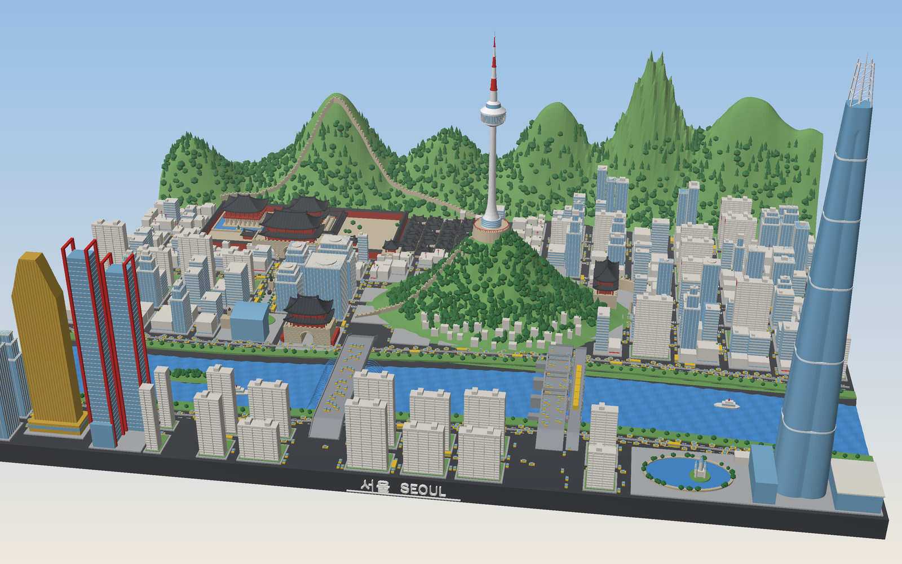

# 서울 디오라마 (Tinkercad용 3D 모델)

200 × 150 mm 판 위에 서울 한 장면을 담은 3D 모델입니다. 가장 높은 곳인 롯데월드타워 꼭대기가 약 99 mm입니다.
Tinkercad에서 바로 불러올 수 있는 **STL** 파일입니다. 단위는 mm입니다.



## 파일

| 파일 | 설명 |
| --- | --- |
| `seoul_diorama.stl` | 전체 모델을 한 파일로 합친 것 (약 21 MB, 삼각형 약 42만 개) |
| `parts/*.stl` | 같은 위치 기준의 색깔별 부품 16개. 따로 불러와서 색을 칠할 때 씁니다 |
| `preview*.png` | 미리보기 이미지 |
| `build_seoul.py` | 모델을 만드는 파이썬 스크립트 (`python3 build_seoul.py`) |
| `render_preview.py` | 미리보기 이미지를 만드는 스크립트 |

## Tinkercad에서 불러오기

1. [tinkercad.com](https://www.tinkercad.com)에서 **3D 디자인 → 새로 만들기**를 누릅니다.
2. 오른쪽 위의 **가져오기(Import)** 를 누르고 `seoul_diorama.stl`을 고릅니다.
3. 단위는 **밀리미터**, 크기는 **100%** 그대로 두고 가져옵니다.
   (Tinkercad의 가져오기 한도는 25 MB이고, 이 파일은 약 21 MB입니다. 처리에 1~2분 걸릴 수 있습니다.)

### 색칠해서 보고 싶다면

STL 파일에는 색 정보가 없어서 한 파일로 불러오면 한 가지 색으로 보입니다.
`parts` 폴더의 파일 16개를 하나씩 가져와서 각각 **모양 → 색상**으로 칠하세요.

부품 파일마다 같은 두 모서리(왼쪽 앞 바닥, 오른쪽 뒤 꼭대기)에 0.3 mm짜리 **정렬용 작은 큐브**가 들어 있어서
모든 부품의 크기 상자가 똑같습니다. 그래서 가져온 부품들이 저절로 제자리에 겹쳐집니다.
위치가 어긋났다면 전부 선택한 뒤 **정렬(Align)** 로 왼쪽·앞·아래를 맞추면 됩니다.
다 맞춘 뒤에는 전부 **그룹화**해 두면 편합니다. 오른쪽 뒤 공중에 떠 있는 작은 점이 그 정렬용 큐브입니다.

| 부품 | 추천 색 | 들어 있는 것 |
| --- | --- | --- |
| `base` | 진회색 | 바닥판, 도로(아스팔트), 한강 바닥 |
| `water` | 파랑 | 한강 물결, 경회루 연못, 석촌호수, 분수 물줄기 |
| `greenery` | 연두 | 남산, 북한산·북악산, 한강공원 잔디, 옥상 물탱크 |
| `trees` | 진초록 | 나무 약 4,000그루 |
| `blocks` | 연회색 | 보도, 광장, 중앙분리대 |
| `markings` | 흰색 | 차선, 횡단보도, 케이블카 줄, 앞면 글씨 `서울 SEOUL` |
| `buildings` | 미색 | 아파트, 주택, 빌딩 외벽, 유람선 |
| `glass` | 하늘색 | 유리 빌딩, 롯데월드타워, 서울시청 신청사 |
| `landmarks` | 흰색 | N서울타워, 롯데월드타워 꼭대기 랜턴 |
| `gold` | 금색 | 63빌딩, 세종대왕상 |
| `stone` | 베이지 | 성문 석축, 한양도성 성곽, 월대, 봉수대 |
| `palace` | 빨강 | 궁궐 기둥·벽·공포 |
| `roofs` | 먹색 | 기와지붕, 이순신 장군상, 거북선 |
| `bridges` | 회색 | 반포대교·잠수교, 아치교와 철교 |
| `vehicles` | 노랑 | 자동차, 버스, 지하철 2호선 |
| `accents` | 빨강 | 교회 십자가, N서울타워 안테나 띠, 파크원 프레임, 케이블카 |

## 모델에 들어 있는 것

- **경복궁**: 홍예문 3개가 뚫린 광화문(2층 문루, 공포, 잡상), 해치상, 흥례문과 행각, 영제교,
  근정전(2단 월대·난간·계단, 품계석 두 줄, 드므), 경회루(돌기둥 48개, 돌다리 3개, 연못 속 섬), 동십자각
- **북촌 한옥마을**: ㄱ·ㄷ·ㅁ자 한옥과 기와 얹은 담장
- **광화문광장**: 이순신 장군상(거북선, 분수), 세종대왕상, 가로수, 양쪽 차로
- **서울시청**: 파도 모양 유리 신청사, 시계탑 있는 구청사, 타원형 서울광장
- **숭례문**, 반원형 옹성을 두른 **흥인지문**
- **남산**: N서울타워(전망층 창틀, 빨강·흰색 안테나), 사랑의 자물쇠 울타리, 봉수대 5기, 팔각정,
  케이블카(곤돌라 2대), 산비탈의 해방촌 집들, 남산 성곽
- **북한산·북악산**: 능선을 따라 오르내리는 한양도성, 화강암 봉우리
- **한강**: 물결, 밤섬, 반포대교(달빛무지개분수 물줄기)와 잠수교, 3경간 아치교와 지하철 2호선 철교,
  유람선, 강변북로·올림픽대로의 차량과 차선
- **강남·여의도·잠실**: 발코니가 층마다 있는 아파트 단지와 주차장, 63빌딩, 빨간 프레임의 파크원,
  롯데월드타워(모서리가 둥근 정사각형 단면, 세로 이음선, 다이아그리드 왕관), 석촌호수와 매직아일랜드 성
- **도시 곳곳**: 헬기장이 있는 유리 빌딩, 옥상 물탱크, 빨간 십자가, 상가 차양

## 3D 프린팅할 때

- 모든 부품은 닫힌 도형(watertight)으로 만들어서 슬라이서에서 그대로 쓸 수 있습니다.
- 차선, 나무 기둥, 분수 물줄기처럼 0.1~0.2 mm인 디테일은 FDM 프린터에서는 잘 나오지 않습니다.
  레진(SLA) 프린터를 쓰거나, Tinkercad에서 크기를 키워서(예: 200%) 출력하세요.
- 한 번에 출력하기 어려우면 `parts` 부품별로 출력해서 붙이는 방법도 있습니다.

## 다시 만들기

```bash
pip install numpy pillow
python3 build_seoul.py      # STL 생성
python3 render_preview.py   # 미리보기 PNG 생성
```

난수 시드가 고정되어 있어서 실행할 때마다 같은 모델이 나옵니다.
